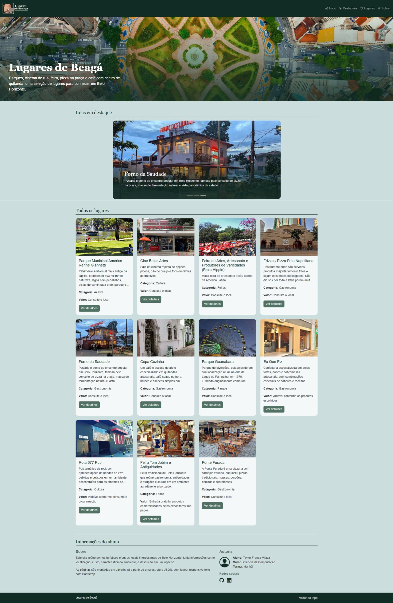
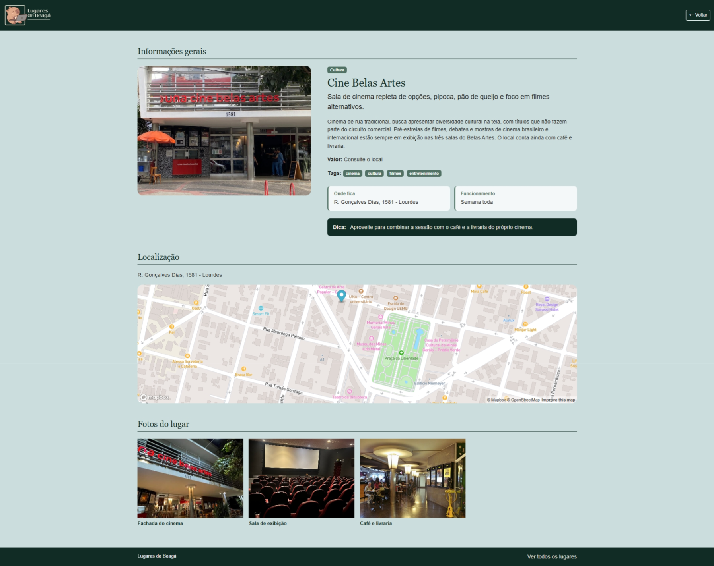

# Trabalho Prático - Semana 14

## Informações do trabalho

- Nome: Tayler França Vilaça
- Matricula: 923887
- Proposta de projeto escolhida: Lugares e Experiências 
- Breve descrição sobre seu projeto: esse site reúne meus pontos turísticos e outros locais favoritos de Belo     Horizonte, junta informações como localização, custo, característica do ambiente, e descrição em um lugar só.

**Print da tela com a implementação**

Uma vez que meu site retrata alguns dos meus lugares favoritos de BH, optei por adicionar a funcionalidade do MAPBOX. Desse modo, na página de detalhes de cada atração é possível ver seu local em um mapa, deixando a informação de endereço mais visível e o site mais dinâmico.

